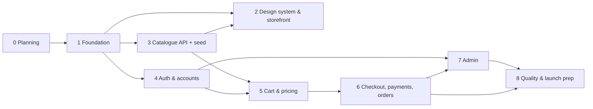

# Implementation Plan

Detailed task lists live in [`tasks/`](tasks/MASTER_TASKS.md). This file explains the order,
dependencies and the "definition of done" for each milestone.

## Milestones and dependencies

| # | Milestone | Depends on | Definition of done |
|---|-----------|-----------|--------------------|
| 0 | Discovery & planning | — | Docs, ADRs, skills, CLAUDE.md, task tracker created and checked by `scripts/check_docs.py` |
| 1 | Foundation | 0 | DB starts; backend health + error format + CSRF + headers tested; frontend shell renders routes and calls the API; lint/type/test commands pass |
| 2 | Design system & storefront | 1, 3 | Token-based components; home, listing, search, product, supporting pages fully interactive and responsive; component tests |
| 3 | Database-backed catalogue | 1 | Catalogue tables + seed; public catalogue APIs with filters/sort/search/pagination; pricing engine core; API tests |
| 4 | Auth & accounts | 1 | Cookie sessions, CSRF, RBAC, rate limits, account pages, addresses, wishlist; access-control tests |
| 5 | Cart & pricing | 3, 4 | Server cart, full pricing engine incl. discounts/coupons/tax/rounding, price-change acceptance; tests |
| 6 | Checkout, payments, orders | 5 | Idempotent order creation, reservations, Razorpay (REST) + simulator, webhooks, retries, expiry, cancellation, emails, confirmation and order pages; payment/webhook/concurrency tests; e2e J3–J6 |
| 7 | Administration | 4, 6 | All admin pages with permission checks and audit logs; gold-rate workflow; e2e J8–J9 |
| 8 | Quality & launch prep | all | Full e2e suite, a11y/perf/security reviews recorded, deployment files, checklist walkthrough, delivery report |

### Planned deviation from the brief's ordering
The brief suggests building the storefront on temporary sample data (Phase 2) before the database
catalogue (Phase 3). We build the **catalogue API and seed first (Phase 3 backend), then the
storefront pages directly against it (Phase 2)**. Same outcome, but no throwaway fixture code and no
risk of fake data shipping in the bundle. Sample content comes from the clearly-flagged seed data.

## Verification at each checkpoint
1. `scripts/check.ps1` (lint, types, unit + API tests for both apps).
2. Manual run of the affected journey in the browser (desktop and mobile widths).
3. Update `PROJECT_STATUS.md`, the phase task file, `FEATURE_MATRIX.md`, `TEST_RESULTS.md`, `CHANGELOG.md`.
4. Commit on the working branch.

## Risks and mitigations
| Risk | Mitigation |
|------|-----------|
| No Razorpay keys yet | REST client tested with mocked HTTP; simulator for e2e; the real sandbox test is a documented launch step |
| No Docker | Embedded PostgreSQL 17 (verified working) |
| Very new library versions (Vite 8, React Router 8, Vitest 5, TS 6) | Versions pinned; peer ranges checked; docs consulted for breaking changes |
| Tax/legal uncertainty | Everything configurable; placeholders flagged; owner checklist |
| Scope size | Strict phase order; each phase ends at a verified, committed checkpoint with resume notes |
