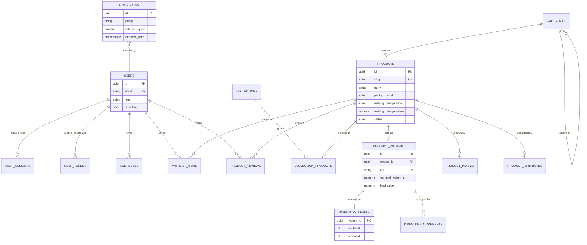
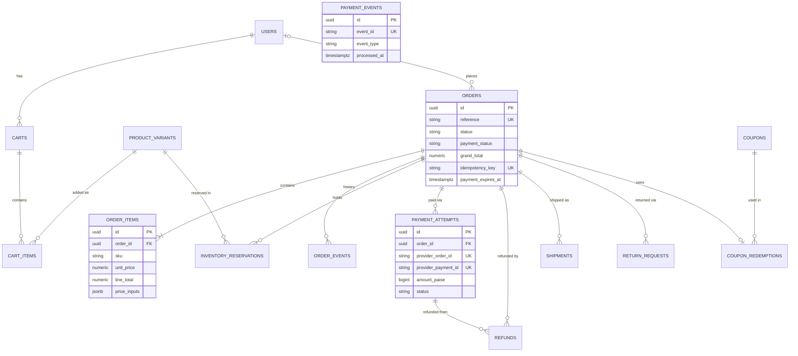

# Entity Relationship Diagram

Rendered by any Mermaid-capable Markdown viewer (GitHub, VS Code with a Mermaid extension).
Column details are in [DATABASE_SCHEMA.md](DATABASE_SCHEMA.md). Only key columns are shown.

## Identity, catalogue and pricing

## Cart, checkout, orders and payments

`PAYMENT_EVENTS` is linked to payment attempts through the provider ids inside its payload, not
through a foreign key. That way a webhook for an unknown order can still be stored and
investigated.
