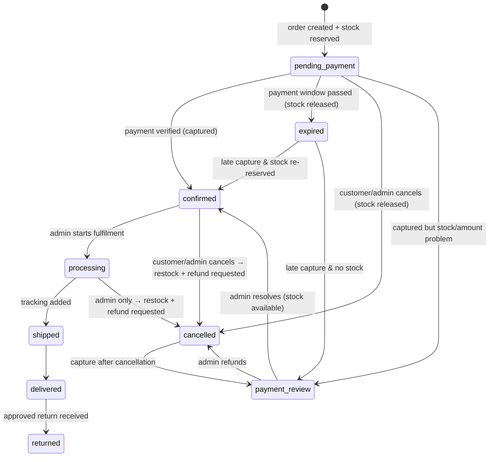

# Inventory and Orders

Decision record: [ADR-0007](ADR/0007-inventory-locking.md). Code: `backend/app/services/inventory.py`,
`backend/app/services/orders.py`, `backend/app/services/checkout.py`.

## 1. Stock model
```
available = on_hand − reserved           (shown to customers as In stock / Only N left / Out of stock)
```
| Operation | on_hand | reserved | Movement reason | When |
|-----------|:-:|:-:|-----------------|------|
| Initial stock / admin adjustment | ±n | – | `initial` / `adjustment` (note required) | Admin |
| Reserve | – | +q | `reservation` | Order created |
| Release | – | −q | `reservation_release` | Order expired / cancelled before payment |
| Commit (sale) | −q | −q | `sale` | Payment verified |
| Restock after cancellation | +q | – | `cancellation_restock` | Paid order cancelled before shipping |
| Restock after return | +q | – | `return_restock` | Return received and approved as resellable |

* All changes happen in `inventory.py` functions that take an open DB session, lock the
  `inventory_levels` rows (`SELECT … FOR UPDATE`, ordered by `variant_id`), validate, update and
  insert a movement row. The caller's transaction commits everything together.
* The database `CHECK (reserved <= on_hand AND on_hand >= 0 AND reserved >= 0)` is the final guard.
* Admin adjustments cannot reduce `on_hand` below `reserved`.
* The cart does **not** reserve stock. Adding to the cart only checks availability. Reservation
  happens when the order is created, so abandoned carts cannot lock up one-of-a-kind pieces.

## 2. Order status machine



`payment_status` ∈ {`unpaid`, `authorized`, `paid`, `failed`, `refund_pending`,
`partially_refunded`, `refunded`} is tracked separately and only changed by the payment service
(never directly by an admin).

Transitions are defined in one table in `orders.py` (`ALLOWED_TRANSITIONS`). Any other change raises
`INVALID_STATE_TRANSITION`. Every transition writes an `order_events` row (shown to the customer as a
timeline where `kind` is customer-visible) and, for admin actions, an `audit_logs` row.

## 3. Order creation (checkout service), in one transaction
1. Load the cart and lines; reject an empty cart.
2. Validate the contact details, address (Indian PIN code, state), shipping method and serviceability.
3. Lock the involved `inventory_levels` rows in variant-id order; check `available >= quantity` for
   each line (`409 OUT_OF_STOCK` lists the offending lines).
4. Recalculate all prices with the pricing engine; validate the coupon (locking the coupon row for
   usage limits).
5. Compare with `expected_total` (`409 PRICE_CHANGED` if different).
6. Insert the order (`pending_payment`, `payment_expires_at = now + window`), items (snapshots),
   reservations, coupon redemption (`reserved`) and an `order_created` event.
7. Commit. Then create the provider (Razorpay) order *outside* the DB transaction, and insert the
   `payment_attempt`. If Razorpay is unavailable, the order stays pending and the customer can retry
   payment; the reservation expires normally.
8. Mark the cart `converted` only after payment is verified, so a customer who abandons payment
   still has their cart. A new checkout from the same cart while an order is pending reuses that
   pending order if the cart contents are unchanged.

## 4. Cancellation
| Who | Allowed when | Effect |
|-----|-------------|--------|
| Customer | `pending_payment` | `cancelled`, reservations released |
| Customer | `confirmed` (not yet processing) | `cancelled`, stock restocked, refund record `requested` for the full amount |
| Customer | later | Not allowed. They are told to contact support or request a return after delivery |
| Admin (`orders:write`) | `pending_payment`, `confirmed`, `processing` | Same effects. A reason is required |

Refunds are executed against Razorpay by an admin with `orders:refund` (see PAYMENT_FLOW §2.11).

## 5. Returns and exchanges
* Available for `delivered` orders, for items whose product had `return_eligible`/`exchange_eligible`
  set at order time (snapshotted into `order_items.price_inputs`), within `return_window_days` of
  delivery.
* `requested → approved/rejected → received → refunded/closed`. On `received`, the admin chooses
  whether each item is restocked (`return_restock`).

## 6. Expiry job
Every minute (and on demand with `python -m app.cli run-jobs`):
```
SELECT … FROM orders WHERE status='pending_payment' AND payment_expires_at < now()
FOR UPDATE SKIP LOCKED LIMIT 50
```
For each order: reconcile with the provider (fetch payments for its attempts). If one was captured,
`mark_order_paid`. Otherwise release reservations, release the coupon redemption, set `expired`, and
write an event.
