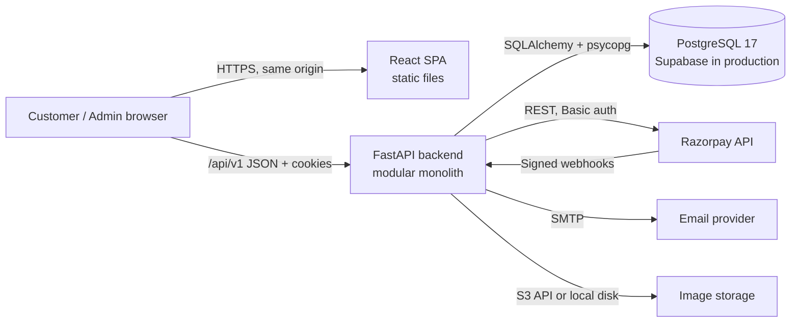

# System Architecture

## 1. Big picture



* The browser only ever talks to **our** backend. It never talks to the database, and it never
  receives Razorpay secrets, SMTP passwords or storage credentials.
* The only Razorpay value the browser receives is the public **key id** plus the Razorpay
  order id/amount for the payment pop-up (Razorpay Checkout.js).
* The backend is the single source of truth for prices, stock, order totals, payment status and
  permissions. Values sent by the browser (prices, totals, roles, stock) are never trusted.

## 2. Backend layers

```
HTTP request
  → middleware (request id, security headers, CSRF check, body-size limit)
  → router  (app/api/v1/routes/*.py)   : parse/validate input (Pydantic), call ONE service function
  → deps    (app/api/deps.py)          : current user, permission checks, DB session
  → service (app/services/*.py)        : business rules, transactions, authorization of ownership
  → models  (app/models/*.py)          : SQLAlchemy tables
  → PostgreSQL
```

Rules:
1. Routers contain **no business logic** — no price maths, no stock maths, no status changes.
2. Services never import FastAPI `Request`/`Response`; they raise `AppError` subclasses
   (`NotFound`, `Conflict`, `Forbidden`, `ValidationFailed`, …) which a single exception handler turns
   into the standard error response.
3. Money and weights are `decimal.Decimal` everywhere in Python and `NUMERIC` in PostgreSQL.
4. Anything that changes stock, orders or payments runs inside one database transaction and locks
   the rows it changes.

### Backend folder layout

```
backend/
├── app/
│   ├── main.py                 # create_app(): middleware, routers, exception handlers
│   ├── cli.py                  # python -m app.cli <command>: create-admin, seed, export-openapi, ...
│   ├── core/                   # cross-cutting: config, db, errors, security, csrf, rate limits, logging, money
│   ├── models/                 # SQLAlchemy models grouped by domain
│   ├── schemas/                # Pydantic request/response models grouped by domain
│   ├── services/               # business logic grouped by domain
│   │   ├── pricing.py          # the gold pricing engine (pure functions + rate lookup)
│   │   ├── inventory.py        # reserve / commit / release / adjust (row locks)
│   │   ├── checkout.py         # quote + order creation
│   │   ├── payments/           # gateway interface, razorpay.py, simulator.py, service.py
│   │   ├── email/              # outbox + senders + templates
│   │   └── ...
│   └── api/
│       ├── deps.py             # get_db, get_current_user, require_permission(...)
│       └── v1/routes/          # one module per domain; admin/ sub-package for admin endpoints
├── alembic/                    # migrations
├── tests/                      # pytest (unit + API integration against real PostgreSQL)
└── openapi.json                # exported API contract (input for frontend type generation)
```

## 3. Frontend layers

```
frontend/src/
├── main.tsx / router.tsx       # React Router data router; admin routes are lazy-loaded
├── api/                        # openapi-fetch client, generated schema.d.ts, TanStack Query hooks per domain
├── components/
│   ├── ui/                     # design-system primitives: Button, Input, Select, Dialog, Sheet, Badge, ...
│   ├── layout/                 # Header, Footer, AnnouncementBar, MobileNav, AdminLayout
│   ├── product/                # ProductCard, ProductGallery, PriceBreakdown, VariantPicker, ...
│   └── ...
├── pages/                      # one component per route (storefront/, auth/, account/, admin/)
├── lib/                        # formatting (₹), validation schemas, small helpers
└── styles/index.css            # Tailwind v4 + design tokens
```

Rules:
1. Components display what the API returns. They never calculate prices, taxes or totals.
2. All server data goes through TanStack Query hooks in `src/api/`. Mutations invalidate the
   affected queries (e.g. adding to cart invalidates `['cart']`).
3. Every data screen handles loading, empty, error (with retry) and success states.
4. Admin UI checks are cosmetic only; the backend enforces every permission.

## 4. Key flows

| Flow | Document |
|------|----------|
| Login, sessions, CSRF, roles | [AUTHENTICATION.md](AUTHENTICATION.md) |
| Price calculation | [PRICING_ENGINE.md](PRICING_ENGINE.md) |
| Checkout → Razorpay → webhook | [PAYMENT_FLOW.md](PAYMENT_FLOW.md) |
| Reservations, order states, cancellations, returns | [INVENTORY_AND_ORDERS.md](INVENTORY_AND_ORDERS.md) |
| Threat model and controls | [SECURITY_MODEL.md](SECURITY_MODEL.md) |
| Tables | [DATABASE_SCHEMA.md](DATABASE_SCHEMA.md), [ER_DIAGRAM.md](ER_DIAGRAM.md) |
| Endpoints | [API_CONTRACT.md](API_CONTRACT.md) |

## 5. Background work

The app runs a small in-process background loop (enabled by `BACKGROUND_JOBS_ENABLED=true`) that
every 60 seconds:
1. expires unpaid orders past their payment window and releases their stock reservations;
2. dispatches pending `email_outbox` rows.

Each job uses `SELECT ... FOR UPDATE SKIP LOCKED`, so running several app instances is safe. The same
jobs can be triggered manually with `python -m app.cli run-jobs`. Stock is also checked lazily during
checkout, so correctness never depends on the loop running on time.

## 6. Environments

| Environment | Frontend | Backend | Database | Payments | Email |
|-------------|----------|---------|----------|----------|-------|
| development | `vite` dev server :5180 (proxies `/api`) | `uvicorn --reload` :8010 | embedded PostgreSQL :54329 `anvika_dev` | simulator or Razorpay test keys | file sink |
| test (automated) | Vitest / Playwright | TestClient / uvicorn | `anvika_test` | simulator + mocked Razorpay | in-memory |
| production | static build behind CDN/reverse proxy | container (uvicorn workers) | Supabase PostgreSQL 17 | Razorpay live keys | SMTP |

See [`docs/operations/DEPLOYMENT.md`](../operations/DEPLOYMENT.md).
