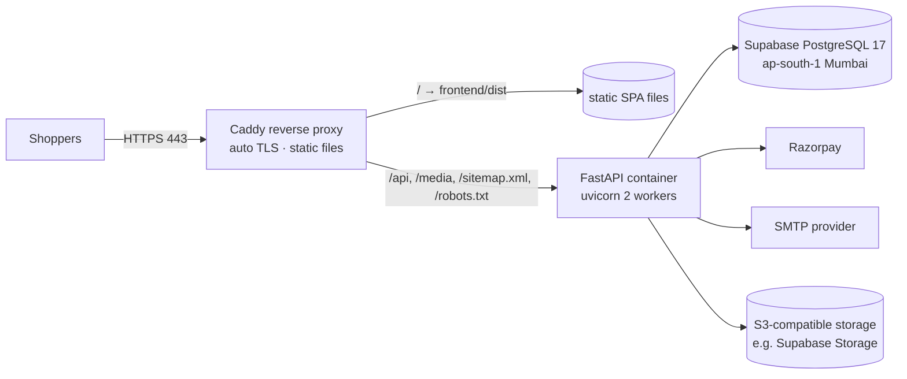

# Deployment

> **Status: not yet deployed.** The steps below are the plan. Each step will be marked
> "verified" once it has actually been executed. Do not consider the site live until the
> production checklist is complete.

> **Hosting on Vercel?** Follow [§7 Deploying on Vercel](#7-deploying-on-vercel) (ADR-0011). The rest
> of this page describes the VM + Docker + Caddy option, whose Supabase/Razorpay/email steps also apply.

## 1. Recommended architecture (small store, low cost, same-origin cookies)



* **One small Linux VM in India** (e.g. AWS Lightsail Mumbai, DigitalOcean Bangalore, or GCP
  asia-south1) running Docker Compose with two containers: `caddy` and `backend`. Choosing a provider
  is an owner decision, so compare current pricing.
* Caddy serves the built frontend and proxies API traffic to the backend on the **same origin**, which
  keeps cookies `SameSite=Lax/Strict` and avoids CORS entirely (ADR-0003).
* The database is Supabase. Images go to S3-compatible storage, so the VM keeps no important state
  and can be rebuilt.
* Alternatives: a static host (Cloudflare Pages / Netlify / Vercel) with a rewrite of `/api/*` to the
  backend host also keeps the same origin. The frontend never needs to know the backend's real host.

## 2. One-time setup
1. **Supabase**
   1. Create a project in region **South Asia (Mumbai)**. Save the database password in a password
      manager.
   2. *Project Settings → Database → Connection string → Session pooler*. Copy the URI, change the
      prefix to `postgresql+psycopg://`, and append `?sslmode=require`. This becomes `DATABASE_URL`.
   3. *Project Settings → Data API*: disable it (we do not use PostgREST). Our migrations also enable
      RLS with no policies on every table as a second safeguard.
   4. *Storage*: create a **public** bucket `product-images` and S3 access keys (for `S3_*` variables).
      Product images are public by nature. Nothing else goes in this bucket.
   5. Enable point-in-time recovery / backups according to the plan (see BACKUP_AND_RESTORE.md).
2. **Domain & DNS**: point `www.<domain>` (and the apex) to the VM. Caddy obtains TLS certificates
   automatically.
3. **Razorpay**: follow [PAYMENT_PROVIDER_SETUP.md](PAYMENT_PROVIDER_SETUP.md). Use test keys on the
   staging environment first.
4. **Email**: follow [EMAIL_SETUP.md](EMAIL_SETUP.md).
5. **Secrets**: create `/opt/store/backend.env` on the server (permissions `600`) with all production
   variables from [ENVIRONMENT_VARIABLES.md](../development/ENVIRONMENT_VARIABLES.md).
   `APP_ENV=production`. Keep `ALLOW_SEARCH_INDEXING=false` on staging and until launch day.
6. **Server layout**: clone the repository to `/opt/store` (only `deploy/` is used on the server),
   `cp deploy/.env.example deploy/.env` and set `SITE_DOMAIN`, `APEX_DOMAIN`, `BACKEND_IMAGE`.
   The built storefront goes in `/opt/store/site`.

## 3. Release procedure (every deploy)
```bash
# On your machine
powershell -File scripts/check.ps1                 # all lint, type checks and tests must pass
cd frontend && npm run build && cd ..              # produces frontend/dist
docker build -t store-backend:<git-sha> backend    # or let CI build it

# On the server
# 1) back up the database (Supabase dashboard or pg_dump, see BACKUP_AND_RESTORE.md)
# 2) run migrations with the NEW image before switching traffic
docker run --rm --env-file /opt/store/backend.env store-backend:<git-sha> python -m alembic upgrade head
# 3) upload frontend/dist to /opt/store/site and restart the backend with the new image
docker compose -f deploy/docker-compose.prod.yml up -d
# 4) smoke test
curl -fsS https://www.<domain>/api/v1/health
```
Then run the post-deploy checks in the [production checklist](PRODUCTION_CHECKLIST.md).

## 4. Rollback
* Frontend: re-upload the previous `dist` (keep the last 3 builds on the server).
* Backend: `docker compose up -d` with the previous image tag. Our migrations follow
  expand/contract rules, so the previous version remains compatible with the newer schema.
* Database: restore only for data corruption (see BACKUP_AND_RESTORE.md). It is a last resort.

## 5. Files
| File | What it does |
|------|--------------|
| `backend/Dockerfile` | Python 3.13 slim image, pinned dependencies, non-root user, health check, `uvicorn` with 2 workers (background jobs run inside; SKIP LOCKED makes that safe) |
| `deploy/docker-compose.prod.yml` | `backend` (read-only filesystem, no new privileges, `TRUSTED_PROXY_COUNT=1`, JSON logs) and `caddy` (ports 80/443, certificates kept in a volume) |
| `deploy/Caddyfile` | Automatic HTTPS; bare domain → `www` redirect; CSP and security headers; `/api`, `/media`, `/sitemap.xml`, `/robots.txt` → backend; storefront from `/srv/site` with SPA fallback; `/assets/*` cached one year (missing files are a plain 404, never `index.html`); everything else `no-cache`; overwrites `X-Forwarded-For` so visitors can't spoof their IP |
| `deploy/.env.example` | Non-secret compose variables (domains, image tag) |
| `frontend/playwright.prod.config.ts` | Runs the E2E suite against staging before a release (never the live store) |

## 6. What has been verified (2026-10-15) — and what has not
| Item | Status |
|------|--------|
| `deploy/Caddyfile` syntax | ✅ `caddy validate` (Caddy 2.10.2, official binary, checksum verified) |
| Caddy behaviour (headers, CSP, caching, SPA fallback, proxying, compression) | ✅ ran the production build behind this Caddyfile on `localhost:5190` (only the domain, site root and backend address substituted); curl checks + the full E2E suite: 62 passed |
| Automatic HTTPS / certificates, HSTS over real TLS | ⏳ needs a real domain (staging) |
| `backend/Dockerfile` builds and starts | ⏳ **not verified** — Docker is not installed on the development machine. First thing to do on the server/CI: `docker build`, then `docker compose up` and the smoke test |
| `docker-compose.prod.yml` | ⏳ not executed (same reason) |
| Supabase, Razorpay test/live keys, SMTP, DNS | ⏳ owner accounts needed (see PRODUCTION_CHECKLIST) |

The site is **not live**. Do not describe it as deployed until §6's open items are done and the
production checklist is complete.

## 7. Deploying on Vercel
One Vercel project, two services, defined in the repository's root `vercel.json` (see
[ADR-0011](../architecture/ADR/0011-vercel-services-deployment.md)): `web` = `frontend/` (Vite) and
`api` = `backend/` (FastAPI, `app.main:app`). `/api/*`, `/sitemap.xml` and `/robots.txt` go to `api`,
everything else to `web`, on **one domain** (cookies and CSRF need that).

### Files that make this work
| File | Purpose |
|------|---------|
| `vercel.json` | Services, routing, the `web` security headers/CSP, SPA fallback, cron schedule |
| `backend/pyproject.toml` | Dependencies read from `backend/requirements.txt` (one pinned list for Vercel and Docker); `packages = ["app"]` |
| `backend/.python-version` | Python 3.13 |
| `.vercelignore` | Keeps tests, docs, e2e, local data and env files out of the upload |
| `backend/app/api/v1/routes/internal.py` | `/api/v1/internal/cron/run-jobs` and `/refresh-prices` for Vercel Cron |

### Steps
1. **Accounts first** (same as §2): Supabase (Mumbai), S3-compatible bucket for photos (Supabase
   Storage), SMTP provider, Razorpay **test** keys. Run the migrations against Supabase from your
   machine: `cd backend && DATABASE_URL=<session-pooler or direct URL> .venv/Scripts/python -m alembic upgrade head`,
   then `python -m app.cli verify-rls` and create the first admin with `create-admin` (never `seed`
   on production; `catalogue-report --samples` lists sample data still to remove).
2. **Import the GitHub repository** in Vercel → *Add New → Project*. The importer may pre-fill
   Root Directory = `frontend` and Framework = Vite: **clear the Root Directory (repository root) and set
   the Framework Preset to Services**, otherwise `vercel.json` is ignored and `/api` returns 404 (this
   happened on the first preview; fixed through the project settings API).
3. **Project → Settings → Environment Variables** (Production; use *Preview* with test keys):

   | Variable | Value |
   |----------|-------|
   | `APP_ENV` | `production` |
   | `SECRET_KEY` | new random value ≥ 48 characters |
   | `DATABASE_URL` | Supabase **transaction pooler** URI (port 6543), prefix `postgresql+psycopg://`, `?sslmode=require` |
   | `DB_POOL_SIZE` / `DB_MAX_OVERFLOW` / `DB_PREPARE_STATEMENTS` | `1` / `0` / `false` |
   | `PUBLIC_SITE_URL`, `ALLOWED_ORIGINS` | `https://<your domain>` (same value, no trailing slash) |
   | `COOKIE_SECURE` / `TRUSTED_PROXY_COUNT` | `true` / `1` (start-up refuses anything else on Vercel) |
   | `PAYMENT_PROVIDER`, `RAZORPAY_*` | `razorpay` and the keys (test keys on Preview) |
   | `EMAIL_BACKEND`, `SMTP_*`, `EMAIL_FROM` | `smtp` and your provider's values |
   | `STORAGE_BACKEND`, `S3_*` | `s3` and the bucket values (required on Vercel) |
   | `CRON_SECRET` | random ≥ 16 characters (Vercel sends it to the cron endpoints automatically) |
   | `LOG_FORMAT` | `json` |
   | `ALLOW_SEARCH_INDEXING` | `false` until launch day |
   | `VITE_STORE_NAME`, `VITE_SITE_URL` | public values, compiled into the site (never secrets) |

4. **Razorpay webhook URL**: `https://<your domain>/api/v1/webhooks/razorpay` (see
   PAYMENT_PROVIDER_SETUP.md).
5. **Domain**: add the domain in Vercel and point DNS as it instructs. HTTPS is automatic.
6. **First deploy → verify** (Preview deployment first): `/api/v1/health?deep=1`, home page, a product,
   `/robots.txt`, a test purchase with Razorpay test keys, an admin photo upload, and in
   *Settings → Cron Jobs* run `run-jobs` once and read its log (`200` and the JSON counts).
7. **Promote** to production only after the [production checklist](PRODUCTION_CHECKLIST.md).

### Demo preview with a free database (no Supabase/Razorpay/SMTP yet)
A Preview deployment can look and behave like localhost (sample catalogue, cart, checkout with the
payment **simulator**) using a free Neon database added from the Vercel Marketplace
(`vercel integration add neon -e preview`). Preview-only variables used for this (2026-10-16):
`DATABASE_URL` (pooled), `DATABASE_URL_DIRECT` (non-pooled, used for the schema set-up),
`SECRET_KEY`, `DB_POOL_SIZE=1`, `DB_MAX_OVERFLOW=0`, `DB_PREPARE_STATEMENTS=false`,
`COOKIE_SECURE=true`, `TRUSTED_PROXY_COUNT=1`, `EMAIL_BACKEND=console`, `LOG_FORMAT=json`,
`SETUP_DB_ON_BUILD=1`. `APP_ENV` stays unset (development), which allows the simulator.
* `SETUP_DB_ON_BUILD=1` makes `backend/vercel_build.py` run `alembic upgrade head` and the idempotent
  sample `seed` during the **preview** build (never on production builds; tested).
* Preview deployments have their own URLs; on previews the API automatically accepts requests from
  the deployment's own host names (`VERCEL_URL`, `VERCEL_BRANCH_URL`) so cookies/CSRF work.
* **Never** set these on Production, and never use the simulator for real customers.

### Limits you must know about
* **Cron needs the Pro plan.** `run-jobs` runs every minute (expires unpaid orders after the 30-minute
  window, reconciles payments, sends queued emails). Hobby allows daily cron only, so abandoned
  checkouts would keep stock reserved for up to a day; Vercel also limits Hobby to personal,
  non-commercial use — check their current terms before selling from a Hobby project. Alternative to
  Vercel Cron: a GitHub Actions workflow that runs every 5 minutes and calls
  `curl -fsS -H "Authorization: Bearer $CRON_SECRET" https://<your domain>/api/v1/internal/cron/run-jobs`.
* **Request bodies are capped at 4.5 MB** by Vercel (the app allows 10 MB): resize product photos
  before uploading (the server re-encodes them to WebP anyway).
* **Cold starts**: the first request after idle time is slower.
* **Services is a beta feature**; if its behaviour changes, the fallback is two Vercel projects with an
  `/api` rewrite, or the VM option above.
* **Migrations do not run automatically** on deploy (on purpose). Run `alembic upgrade head` first
  whenever a release adds migrations, then deploy.
* Preview deployments get their own URLs: set `PUBLIC_SITE_URL`/`ALLOWED_ORIGINS` for the Preview
  environment to a fixed preview domain, or use the production domain only for production.

### What was verified (2026-10-16)
| Item | Status |
|------|--------|
| `vercel.json` accepted by Vercel CLI 64.3.1; both services detected (Vite, FastAPI) | ✅ `vercel dev -L` |
| Backend dependencies install through `pyproject.toml` + `requirements.txt`; app starts; `/api/v1/health` answered through the `/api/*` rewrite | ✅ (the first attempt found that Vercel's pip install of `backend/` failed on package discovery — fixed in `pyproject.toml`) |
| Frontend through the router: home and deep links return the SPA, security headers and CSP present | ✅ (served by Vite's dev server, not a production build) |
| `/assets/*` caching and 404 behaviour (the SPA fallback excludes `assets/` so a missing hashed file is a real 404, never `index.html` cached for a year — the bug found in the Caddy config) | ⏳ only checkable on a deployed build; `vercel dev` serves assets from Vite's dev server |
| Repeated API requests via `vercel dev -L` | ⚠️ not completed: on this Windows machine the dev server's Python child kept exiting with a console-signal code (`0xC000013A`), so the API could not be exercised further through Vercel's local router. The same app is fully tested directly (312 backend tests; E2E suite) |
| **Real Vercel preview deployment** (2026-10-16, Hobby team, no env vars): build succeeded; `/` and deep links serve the SPA; `/api/v1/health` → 200 through the `/api/*` rewrite; `/robots.txt` served by the API (indexing off by default); `/api/v1/internal/cron/run-jobs` → 404 while `CRON_SECRET` is unset; `/api/v1/products` → 500 as expected (no `DATABASE_URL`) | ✅ |
| Preview deployments sit behind Vercel's login protection (`vercel_authentication`); open them while signed in, or use `vercel curl <url>` | ✅ |
| **Preview with a database** (2026-10-16, Neon): build ran the migrations and seed; `/api/v1/health?deep=1` → database ok, migration `8c558fc9123c`; `/api/v1/products`, `/home`, `/sitemap.xml` → 200; a real browser run (desktop + phone) showed the necklace hero, categories, bestsellers, and added a piece to the cart on the preview origin | ✅ |
| This development machine could not reach Neon on port 5432 (connection reset), so migrations were run by the Vercel build instead of from here | ℹ️ network on this PC |
| Cron wiring under Services (needs `CRON_SECRET` and the Pro plan: Hobby rejects per-minute schedules — the first deploy failed on that, so previews on Hobby need daily schedules), Supabase pooler behaviour, S3 uploads, 4.5 MB limit | ⏳ needs the environment variables and Pro |
