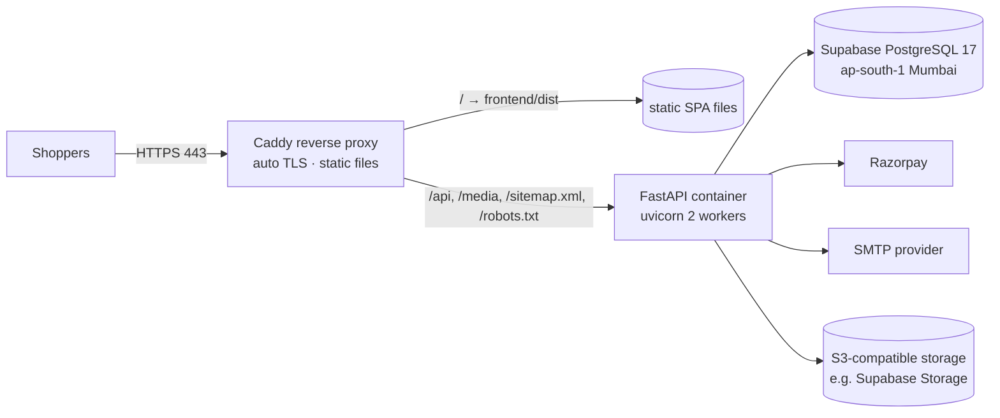

# Deployment

> **Status: not yet deployed.** The steps below are the plan. Each step will be marked
> "verified" once it has actually been executed. Do not consider the site live until the
> production checklist is complete.

## 1. Recommended architecture (small store, low cost, same-origin cookies)



* **One small Linux VM in India** (e.g. AWS Lightsail Mumbai, DigitalOcean Bangalore, or GCP
  asia-south1) running Docker Compose with two containers: `caddy` and `backend`. Choosing a provider
  is an owner decision, so compare current pricing.
* Caddy serves the built frontend and proxies API traffic to the backend on the **same origin**, which
  keeps cookies `SameSite=Lax/Strict` and avoids CORS entirely (ADR-0003).
* The database is Supabase. Images go to S3-compatible storage, so the VM keeps no important state
  and can be rebuilt.
* Alternatives: a static host (Cloudflare Pages / Netlify / Vercel) with a rewrite of `/api/*` to the
  backend host also keeps the same origin. The frontend never needs to know the backend's real host.

## 2. One-time setup
1. **Supabase**
   1. Create a project in region **South Asia (Mumbai)**. Save the database password in a password
      manager.
   2. *Project Settings → Database → Connection string → Session pooler*. Copy the URI, change the
      prefix to `postgresql+psycopg://`, and append `?sslmode=require`. This becomes `DATABASE_URL`.
   3. *Project Settings → Data API*: disable it (we do not use PostgREST). Our migrations also enable
      RLS with no policies on every table as a second safeguard.
   4. *Storage*: create a **public** bucket `product-images` and S3 access keys (for `S3_*` variables).
      Product images are public by nature. Nothing else goes in this bucket.
   5. Enable point-in-time recovery / backups according to the plan (see BACKUP_AND_RESTORE.md).
2. **Domain & DNS**: point `www.<domain>` (and the apex) to the VM. Caddy obtains TLS certificates
   automatically.
3. **Razorpay**: follow [PAYMENT_PROVIDER_SETUP.md](PAYMENT_PROVIDER_SETUP.md). Use test keys on the
   staging environment first.
4. **Email**: follow [EMAIL_SETUP.md](EMAIL_SETUP.md).
5. **Secrets**: create `/opt/store/backend.env` on the server (permissions `600`) with all production
   variables from [ENVIRONMENT_VARIABLES.md](../development/ENVIRONMENT_VARIABLES.md).
   `APP_ENV=production`. Keep `ALLOW_SEARCH_INDEXING=false` on staging and until launch day.
6. **Server layout**: clone the repository to `/opt/store` (only `deploy/` is used on the server),
   `cp deploy/.env.example deploy/.env` and set `SITE_DOMAIN`, `APEX_DOMAIN`, `BACKEND_IMAGE`.
   The built storefront goes in `/opt/store/site`.

## 3. Release procedure (every deploy)
```bash
# On your machine
powershell -File scripts/check.ps1                 # all lint, type checks and tests must pass
cd frontend && npm run build && cd ..              # produces frontend/dist
docker build -t store-backend:<git-sha> backend    # or let CI build it

# On the server
# 1) back up the database (Supabase dashboard or pg_dump, see BACKUP_AND_RESTORE.md)
# 2) run migrations with the NEW image before switching traffic
docker run --rm --env-file /opt/store/backend.env store-backend:<git-sha> python -m alembic upgrade head
# 3) upload frontend/dist to /opt/store/site and restart the backend with the new image
docker compose -f deploy/docker-compose.prod.yml up -d
# 4) smoke test
curl -fsS https://www.<domain>/api/v1/health
```
Then run the post-deploy checks in the [production checklist](PRODUCTION_CHECKLIST.md).

## 4. Rollback
* Frontend: re-upload the previous `dist` (keep the last 3 builds on the server).
* Backend: `docker compose up -d` with the previous image tag. Our migrations follow
  expand/contract rules, so the previous version remains compatible with the newer schema.
* Database: restore only for data corruption (see BACKUP_AND_RESTORE.md). It is a last resort.

## 5. Files
| File | What it does |
|------|--------------|
| `backend/Dockerfile` | Python 3.13 slim image, pinned dependencies, non-root user, health check, `uvicorn` with 2 workers (background jobs run inside; SKIP LOCKED makes that safe) |
| `deploy/docker-compose.prod.yml` | `backend` (read-only filesystem, no new privileges, `TRUSTED_PROXY_COUNT=1`, JSON logs) and `caddy` (ports 80/443, certificates kept in a volume) |
| `deploy/Caddyfile` | Automatic HTTPS; bare domain → `www` redirect; CSP and security headers; `/api`, `/media`, `/sitemap.xml`, `/robots.txt` → backend; storefront from `/srv/site` with SPA fallback; `/assets/*` cached one year (missing files are a plain 404, never `index.html`); everything else `no-cache`; overwrites `X-Forwarded-For` so visitors can't spoof their IP |
| `deploy/.env.example` | Non-secret compose variables (domains, image tag) |
| `frontend/playwright.prod.config.ts` | Runs the E2E suite against staging before a release (never the live store) |

## 6. What has been verified (2026-10-15) — and what has not
| Item | Status |
|------|--------|
| `deploy/Caddyfile` syntax | ✅ `caddy validate` (Caddy 2.10.2, official binary, checksum verified) |
| Caddy behaviour (headers, CSP, caching, SPA fallback, proxying, compression) | ✅ ran the production build behind this Caddyfile on `localhost:5190` (only the domain, site root and backend address substituted); curl checks + the full E2E suite: 62 passed |
| Automatic HTTPS / certificates, HSTS over real TLS | ⏳ needs a real domain (staging) |
| `backend/Dockerfile` builds and starts | ⏳ **not verified** — Docker is not installed on the development machine. First thing to do on the server/CI: `docker build`, then `docker compose up` and the smoke test |
| `docker-compose.prod.yml` | ⏳ not executed (same reason) |
| Supabase, Razorpay test/live keys, SMTP, DNS | ⏳ owner accounts needed (see PRODUCTION_CHECKLIST) |

The site is **not live**. Do not describe it as deployed until §6's open items are done and the
production checklist is complete.
